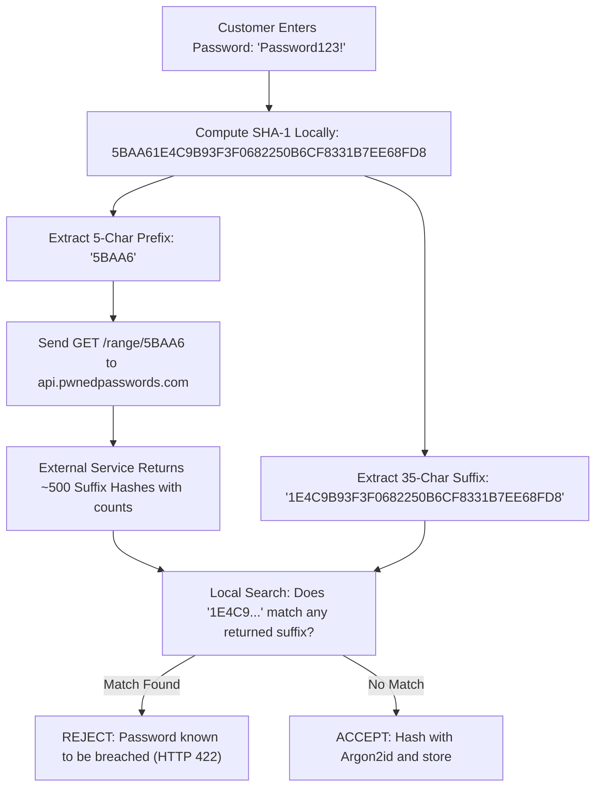

# Breached Password Verification & Privacy Architecture (Task 04, Step 9)

## 1. Requirement & Threat Model

During customer account registration, Swash verifies that the chosen password has not been exposed in previously published public data breaches. 

Attackers routinely use dictionaries of billions of leaked credentials (e.g. RockYou, Collection #1–5) in automated credential stuffing attacks against newly registered accounts. Allowing customers to register with known compromised passwords undermines Argon2id hashing, because an attacker who knows the plain-text password from a prior breach does not need to crack the hash.

---

## 2. Why Sending the Complete Password Is Strictly Unacceptable

Transmitting a plaintext password or even a full SHA-256/Argon2id hash to any external third-party API introduces severe security and privacy hazards:

1. **Third-Party Interception & Trust Dependency:** The external service operator, compromised TLS termination points, or intermediate proxy logs could record the plaintext password together with the customer's origin IP address or metadata, creating a new breach vector.
2. **Regulatory Non-Compliance (NDPA 2023 / GDPR):** Plaintext credentials are sensitive authentication data. Disclosing them outside Swash's security boundary without cryptographic isolation violates the Nigerian Data Protection Act 2023.
3. **Re-identification Risk:** Even if the username is omitted, high-entropy unique passwords can serve as cross-site pseudonymous identifiers tracking users across web services.

---

## 3. Privacy-Preserving k-Anonymity Mechanism

Swash implements the mathematical **$k$-Anonymity model** pioneered by Cloudflare and Troy Hunt (Have I Been Pwned / HIBP):

### Cryptographic Workflow

1. **Local SHA-1 Digest:** The server computes the 40-character hexadecimal SHA-1 digest of the normalised password in memory ([`src/lib/breach-check.ts`](../../src/lib/breach-check.ts)).
2. **Prefix Partitioning ($k$-Anonymity):**
   - The digest is partitioned into a **5-character prefix** (16⁵ = 1,048,576 possible buckets) and a **35-character suffix**.
   - Example (`"Password123!"`):
     - SHA-1: `CBFDAC6008F9CAB4083784CBD1874F76618D2A97`
     - Prefix: `CBFDA`
     - Suffix: `C6008F9CAB4083784CBD1874F76618D2A97`
3. **External Query:**
   - Swash transmits ONLY the 5-character prefix:
     `GET https://api.pwnedpasswords.com/range/CBFDA`
   - Added privacy header: `"Add-Padding": "true"` requests the API to return pseudo-random padding lines, mitigating response-size side-channel analysis.
4. **Local Matching:**
   - The remote service returns a list of several hundred hash suffixes that share that same 5-character prefix, along with breach frequency counts.
   - Swash scans the returned list locally in Node.js memory. If the local suffix appears in the list, the password is recognized as compromised and rejected with HTTP 422.
   - The external service learns only that *someone* queried a 5-character hash prefix shared by thousands of completely different passwords; it never learns which specific suffix was tested or what the password was.

---

## 4. Resilience & Fallback Behaviour

- **Timeout & Failure Mode:** The external check is wrapped in a strict 3-second `AbortController` timeout.
- **Fail-Safe Principle:** If the external HIBP API is unreachable (e.g. temporary network outage, DNS failure, or strict offline development sandbox), the system logs a diagnostic warning and allows registration to proceed rather than creating an outage for legitimate customers.

