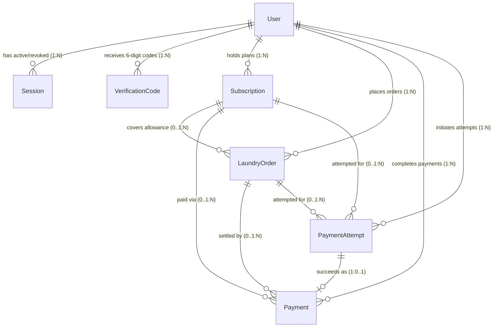

# Task 04 — Step 1: Relational Database Schema Design (`docs/schema.md`)

## 1. Domain Overview & Design Principles

Swash's core product principle ([`AGENTS.md`](../../.agent/rules/AGENTS.md)) is that **accurate, connected customer records are non-negotiable**: every laundry order must link deterministically to its customer (`User`), subscription allowance (`Subscription`), operational collection/delivery state (`LaundryOrder`), payment attempts (`PaymentAttempt`), and confirmed financial transactions (`Payment`), while the AI assistant retrieves approved business knowledge (`KnowledgeChunk`) alongside authorised customer records.

Before writing or running any migration, the relational schema below was designed to satisfy all Swash business and technical requirements across **9 purposeful tables** (the 8 core operational/security tables plus `ServiceEnquiry` from Task 02):

1. **`User`** — Customers and authorised staff accounts.
2. **`Session`** — Server-side authentication sessions with revocable hashed tokens.
3. **`VerificationCode`** — Cryptographically random 6-digit email verification and password-reset codes with expiry, attempt counters, and single-use tracking.
4. **`Subscription`** — Customer laundry plan tier, monthly garment allowance, used/rollover counts, and billing cycle window.
5. **`LaundryOrder`** — Customer laundry collection/delivery orders linked to the customer and optional active subscription.
6. **`Payment`** — Confirmed, immutable financial transactions in kobo (`NGN`).
7. **`PaymentAttempt`** — Separate audit log of every initiated, pending, failed, abandoned, or network-interrupted payment attempt.
8. **`KnowledgeChunk`** — Approved Swash business policy and pricing chunks for the RAG AI assistant.
9. **`EmailJob`** — Persistent transactional email outbox queue for non-blocking background email delivery (`Step 10`).
10. **`ServiceEnquiry`** — Pre-signup customer plan enquiries created in Task 02.

---

## 2. Entity-Relationship Diagram (Reference for Hand-Drawn `evidence/01-schema-drawing.jpg`)

---

## 3. Why `PaymentAttempt` and `Payment` Are Separate Tables

In Nigeria's online payment ecosystem (bank transfers, USSD, Paystack/Flutterwave card gateways, and mobile connections that frequently drop mid-redirect), a single laundry order or subscription renewal frequently generates **multiple payment attempts** before one succeeds:

1. **Operational & Diagnostic Visibility (`PaymentAttempt`):**
   - A customer on a slow mobile connection may initiate a card payment that fails due to bank OTP timeout (`FAILED`), close the modal (`ABANDONED`), or lose connectivity while the webhook is in flight (`PENDING` / `INTERRUPTED`), and then succeed on a second attempt via bank transfer.
   - Recording every attempt in `PaymentAttempt` (with `status`, `failureCode`, `failureReason`, `providerReference`, and timestamps) allows Swash staff and the AI assistant to answer *"Why did my card charge fail?"* or detect duplicate webhook deliveries (`providerReference` idempotency) without polluting accounting ledgers.
2. **Financial & Accounting Integrity (`Payment`):**
   - `Payment` stores **only verified, settled financial transactions** confirmed by a trusted payment webhook or server verification call.
   - Separating `Payment` from `PaymentAttempt` guarantees that revenue queries (`SUM(amountKobo)`), VAT calculations, subscription allowance unlocks, and order settlement checks never accidentally count unconfirmed, failed, or abandoned attempts, and satisfies NDPA 2023 / Nigerian tax-retention rules where settled financial ledger rows must remain immutable even when failed attempt telemetry is pruned.

---

## 4. Complete Table-by-Table Specification

### 4.1 `User` (Customers & Staff)

| Column | Type | Nullable? | Purpose & Constraints |
|---|---|---|---|
| `id` | `String` (`cuid`) | No (`PK`) | Primary key identifier. |
| `fullName` | `String` | No | Customer or staff member's full name (`2–80` chars) used on collection manifests. |
| `email` | `String` | No (`UNIQUE`) | Trimmed, lowercased email address used as the primary login identifier. |
| `phone` | `String` | No | Normalized Nigerian mobile number (`0803...` or `+234...`) for dispatch rider coordination. |
| `passwordHash` | `String` | No | Argon2id encoded hash (`$argon2id$v=19$m=19456,t=2,p=1$...`). Never plaintext. |
| `role` | `String` | No | Access role (`"CUSTOMER"` default, `"STAFF"`, `"ADMIN"`). |
| `preferredPlan` | `String` | No | Selected onboarding subscription tier (`"Individual Subscription"`, `"Family Subscription"`, `"Small Business Subscription"`). |
| `acceptedTermsAt` | `DateTime` | No | Timestamp recording explicit NDPA 2023 & Terms of Service consent at signup. |
| `emailVerifiedAt` | `DateTime?` | Yes (`NULL`) | Populated when the customer verifies their 6-digit email verification code (`NULL` while unverified). |
| `deletedAt` | `DateTime?` | Yes (`NULL`) | Soft-deletion / anonymisation timestamp for Task 05 NDPA account deletion compliance. |
| `createdAt` | `DateTime` | No | Account creation timestamp (`@default(now())`). |
| `updatedAt` | `DateTime` | No | Last profile update timestamp (`@updatedAt`). |

- **Relationships:** `1:N` with `Session`, `VerificationCode`, `Subscription`, `LaundryOrder`, `Payment`, and `PaymentAttempt`.
- **Indexes:**
  - `@unique` B-tree index on `email` — enables $O(\log n)$ login lookups and enforces database-level uniqueness against race-condition duplicate registrations.
  - `@@index([phone])` — speeds up staff/rider lookup by customer phone number.
  - `@@index([role])` — speeds up administrative queries filtering staff vs. customers.

---

### 4.2 `Session` (Server-Side Authentication Sessions)

| Column | Type | Nullable? | Purpose & Constraints |
|---|---|---|---|
| `id` | `String` (`cuid`) | No (`PK`) | Internal session row ID. |
| `tokenHash` | `String` | No (`UNIQUE`) | SHA-256 digest of the high-entropy session token sent in the `HttpOnly` cookie (protects active sessions if database rows are read). |
| `userId` | `String` (`FK`) | No | Foreign key to `User.id` (`onDelete: Cascade`). |
| `ipAddress` | `String?` | Yes | Client IP at session creation for security auditing. |
| `userAgent` | `String?` | Yes | Browser User-Agent string at session creation. |
| `expiresAt` | `DateTime` | No | Hard expiration timestamp for session validity. |
| `revokedAt` | `DateTime?` | Yes | Set on logout or password reset to invalidate the session immediately. |
| `createdAt` | `DateTime` | No | Session creation timestamp (`@default(now())`). |

- **Relationships:** `N:1` with `User` (one user can have multiple active sessions across laptop and phone).
- **Indexes:**
  - `@unique` on `tokenHash` — runs on every authenticated request in middleware/server handlers.
  - `@@index([userId, revokedAt])` — enables fast bulk invalidation of all active sessions for a user on password reset (`Task 05 Step 5`).

---

### 4.3 `VerificationCode` (6-Digit Email Verification & Password Reset Codes)

| Column | Type | Nullable? | Purpose & Constraints |
|---|---|---|---|
| `id` | `String` (`cuid`) | No (`PK`) | Primary key. |
| `userId` | `String` (`FK`) | No | Foreign key to `User.id` (`onDelete: Cascade`). |
| `email` | `String` | No | Target email address at the time the code was issued. |
| `codeHash` | `String` | No | SHA-256 hash of the 6-digit CSPRNG code so raw codes are not exposed in database dumps. |
| `purpose` | `String` | No | `"EMAIL_VERIFICATION"` or `"PASSWORD_RESET"`. |
| `attempts` | `Int` | No | Number of failed verification attempts (`@default(0)`). |
| `maxAttempts` | `Int` | No | Maximum permitted attempts before lockout (`@default(5)`). |
| `expiresAt` | `DateTime` | No | Expiration timestamp (`createdAt + 15 minutes`). |
| `usedAt` | `DateTime?` | Yes | Populated when verified to prevent code reuse (`Step 10`). |
| `createdAt` | `DateTime` | No | Code generation timestamp (`@default(now())`). |

- **Relationships:** `N:1` with `User`.
- **Indexes:**
  - `@@index([userId, purpose, usedAt])` — locates the latest active verification code for a user in milliseconds.
  - `@@index([expiresAt])` — supports scheduled cleanup of expired verification codes.

---

### 4.4 `Subscription` (Customer Laundry Allowances & Billing Cycles)

| Column | Type | Nullable? | Purpose & Constraints |
|---|---|---|---|
| `id` | `String` (`cuid`) | No (`PK`) | Primary key. |
| `userId` | `String` (`FK`) | No | Foreign key to `User.id` (`onDelete: Restrict`). |
| `planName` | `String` | No | `"Individual Subscription"`, `"Family Subscription"`, or `"Small Business Subscription"`. |
| `status` | `String` | No | `"PENDING_PAYMENT"`, `"ACTIVE"`, `"PAST_DUE"`, `"CANCELLED"`, `"EXPIRED"`. |
| `monthlyAllowanceItems` | `Int` | No | Base monthly garment count included in the plan (e.g. `30`, `75`, `150`). |
| `rolloverItems` | `Int` | No | Approved unused items carried over from the prior cycle (`@default(0)`). |
| `usedItems` | `Int` | No | Items deducted by confirmed laundry orders in the current cycle (`@default(0)`). |
| `priceKobo` | `Int` | No | Monthly plan price in Nigerian kobo (`100 kobo = ₦1`). |
| `currentPeriodStart` | `DateTime` | No | Start of current 30-day subscription period. |
| `currentPeriodEnd` | `DateTime` | No | End/expiry of current 30-day subscription period. |
| `createdAt` | `DateTime` | No | Creation timestamp (`@default(now())`). |
| `updatedAt` | `DateTime` | No | Last allowance or status update (`@updatedAt`). |

- **Relationships:** `N:1` with `User`; `1:N` with `LaundryOrder`, `Payment`, and `PaymentAttempt`.
- **Indexes:**
  - `@@index([userId, status])` — retrieves a customer's active subscription and remaining allowance (`monthlyAllowanceItems + rolloverItems - usedItems`).
  - `@@index([currentPeriodEnd])` — identifies expiring subscriptions for renewal reminders.

---

### 4.5 `LaundryOrder` (Orders, Collections & Deliveries)

| Column | Type | Nullable? | Purpose & Constraints |
|---|---|---|---|
| `id` | `String` (`cuid`) | No (`PK`) | Primary key. |
| `orderNumber` | `String` | No (`UNIQUE`) | Human-readable reference (e.g. `SW-2026-0001`) for customer & staff communication. |
| `userId` | `String` (`FK`) | No | Customer who owns the order (`User.id`, `onDelete: Restrict`). |
| `subscriptionId` | `String?` (`FK`) | Yes | Linked `Subscription.id` when items are deducted from a subscription allowance (`NULL` for pay-as-you-go / special duvet orders). |
| `status` | `String` | No | Operational state: `"REQUESTED"`, `"COLLECTION_SCHEDULED"`, `"COLLECTED"`, `"WASHING"`, `"READY_FOR_DELIVERY"`, `"DELIVERED"`, `"CANCELLED"`. |
| `itemCount` | `Int` | No | Number of garments in the order. |
| `specialItemsNotes` | `String?` | Yes | Optional notes for special items (e.g. king duvet, agbada, curtains). |
| `pickupAddress` | `String` | No | Snapshot of the Lagos collection/delivery address for this order. |
| `scheduledPickupAt` | `DateTime` | No | Requested or confirmed pickup window. |
| `collectedAt` | `DateTime?` | Yes | Confirmed collection timestamp (`NULL` until rider confirms pickup). |
| `scheduledDeliveryAt` | `DateTime?` | Yes | Scheduled return delivery window. |
| `deliveredAt` | `DateTime?` | Yes | Confirmed delivery timestamp (`NULL` until rider confirms handoff). |
| `extraChargeKobo` | `Int` | No | Amount due in kobo for out-of-allowance or special items (`@default(0)`). |
| `createdAt` | `DateTime` | No | Order creation timestamp (`@default(now())`). |
| `updatedAt` | `DateTime` | No | Last status update (`@updatedAt`). |

- **Relationships:** `N:1` with `User`; `N:0..1` with `Subscription`; `1:N` with `Payment` and `PaymentAttempt`.
- **Indexes:**
  - `@unique` on `orderNumber` — direct lookup by order reference in staff dashboard and AI assistant.
  - `@@index([userId, status])` — customer dashboard and AI assistant order-status queries.
  - `@@index([scheduledPickupAt, status])` — Lagos dispatch rider manifest queries for upcoming pickups.

---

### 4.6 `PaymentAttempt` (Initiated, Failed, Abandoned & Interrupted Payment Attempts)

| Column | Type | Nullable? | Purpose & Constraints |
|---|---|---|---|
| `id` | `String` (`cuid`) | No (`PK`) | Primary key. |
| `userId` | `String` (`FK`) | No | Customer who initiated the attempt (`User.id`, `onDelete: Restrict`). |
| `subscriptionId` | `String?` (`FK`) | Yes | Target `Subscription.id` if paying for a subscription plan. |
| `orderId` | `String?` (`FK`) | Yes | Target `LaundryOrder.id` if paying for an order / extra item charge. |
| `providerReference` | `String` | No (`UNIQUE`) | Idempotency reference sent to/from the payment gateway (e.g. Paystack reference). |
| `amountKobo` | `Int` | No | Attempted payment amount in kobo. |
| `currency` | `String` | No | ISO currency code (`@default("NGN")`). |
| `channel` | `String?` | Yes | Payment channel (`"card"`, `"bank_transfer"`, `"ussd"`). |
| `status` | `String` | No | `"INITIATED"`, `"PENDING"`, `"SUCCEEDED"`, `"FAILED"`, `"ABANDONED"`, `"INTERRUPTED"`. |
| `failureCode` | `String?` | Yes | Gateway error code (e.g. `"INSUFFICIENT_FUNDS"`, `"OTP_TIMEOUT"`). |
| `failureReason` | `String?` | Yes | Human-readable failure explanation for support/retry guidance. |
| `createdAt` | `DateTime` | No | Attempt start timestamp (`@default(now())`). |
| `updatedAt` | `DateTime` | No | Last webhook/status transition (`@updatedAt`). |

- **Relationships:** `N:1` with `User`; `N:0..1` with `Subscription` and `LaundryOrder`; `1:0..1` with `Payment`.
- **Indexes:**
  - `@unique` on `providerReference` — prevents duplicate webhook processing.
  - `@@index([userId, status, createdAt])` — retrieves recent failed/interrupted payment attempts for customer retry UI.

---

### 4.7 `Payment` (Confirmed Financial Ledger Records)

| Column | Type | Nullable? | Purpose & Constraints |
|---|---|---|---|
| `id` | `String` (`cuid`) | No (`PK`) | Primary key. |
| `paymentAttemptId` | `String` (`FK`) | No (`UNIQUE`) | `1:1` link to the exact `PaymentAttempt.id` that succeeded. |
| `userId` | `String` (`FK`) | No | Customer who made the payment (`User.id`, `onDelete: Restrict`). |
| `subscriptionId` | `String?` (`FK`) | Yes | Linked `Subscription.id` if settling a subscription renewal. |
| `orderId` | `String?` (`FK`) | Yes | Linked `LaundryOrder.id` if settling an order charge. |
| `providerReference` | `String` | No (`UNIQUE`) | Gateway transaction reference for accounting reconciliation. |
| `receiptNumber` | `String` | No (`UNIQUE`) | Official Swash receipt identifier (e.g. `RCP-2026-0001`). |
| `amountKobo` | `Int` | No | Confirmed settled amount in kobo. |
| `currency` | `String` | No | ISO currency code (`@default("NGN")`). |
| `customerEmailSnapshot` | `String` | No | Snapshot of customer's billing email at time of payment (preserved even if user later changes email or anonymises account). |
| `confirmedAt` | `DateTime` | No | Authoritative gateway settlement timestamp (`@default(now())`). |

- **Relationships:** `1:1` with `PaymentAttempt`; `N:1` with `User`; `N:0..1` with `Subscription` and `LaundryOrder`.
- **Indexes:**
  - `@unique` on `paymentAttemptId`, `providerReference`, and `receiptNumber` — enforces strict idempotency so a single payment attempt can never create two confirmed `Payment` rows.
  - `@@index([userId, confirmedAt])` — customer billing history queries.

---

### 4.8 `KnowledgeChunk` (Approved Swash RAG Knowledge Base)

| Column | Type | Nullable? | Purpose & Constraints |
|---|---|---|---|
| `id` | `String` (`cuid`) | No (`PK`) | Primary key. |
| `documentSlug` | `String` | No | Source document identifier (e.g. `"pricing-policy-2026"`, `"subscription-rollover-rules"`). |
| `sectionTitle` | `String` | No | Heading of the policy section for citation in AI assistant responses. |
| `chunkIndex` | `Int` | No | Sequential ordering within the source document. |
| `content` | `String` | No | Approved authoritative text passage retrieved by the AI assistant. |
| `category` | `String` | No | `"PRICING"`, `"SUBSCRIPTIONS"`, `"ORDERS"`, `"GARMENT_CARE"`. |
| `embeddingJson` | `String?` | Yes | Serialized vector embedding for semantic similarity retrieval. |
| `isApproved` | `Boolean` | No | Guard flag (`@default(true)`) ensuring only approved business information is retrieved. |
| `updatedAt` | `DateTime` | No | Last policy review timestamp (`@updatedAt`). |

- **Indexes:**
  - `@@unique([documentSlug, chunkIndex])` — prevents duplicate chunk ingestion during knowledge-base syncs.
  - `@@index([category, isApproved])` — fast pre-filtering of approved chunks by topic (`PRICING`, `SUBSCRIPTIONS`, `ORDERS`).

---

### 4.9 `EmailJob` (Background Email Outbox Queue — Step 10)

| Column | Type | Nullable? | Purpose & Constraints |
|---|---|---|---|
| `id` | `String` (`cuid`) | No (`PK`) | Primary key. |
| `userId` | `String?` (`FK`) | Yes | Optional link to `User.id` (`onDelete: SetNull`). |
| `toEmail` | `String` | No | Recipient email address. |
| `subject` | `String` | No | Email subject line. |
| `templateType` | `String` | No | `"EMAIL_VERIFICATION"` or `"WELCOME"`. |
| `payloadJson` | `String` | No | Serialized template parameters (e.g. 6-digit code, customer first name, expiry). |
| `status` | `String` | No | `"PENDING"`, `"PROCESSING"`, `"SENT"`, `"FAILED"`. |
| `attempts` | `Int` | No | Delivery attempt counter (`@default(0)`). |
| `lastError` | `String?` | Yes | Last SMTP error message captured on delivery failure (`Step 10`). |
| `scheduledAt` | `DateTime` | No | Earliest timestamp to process the job (`@default(now())`). |
| `sentAt` | `DateTime?` | Yes | Timestamp when SMTP accepted the message. |
| `createdAt` | `DateTime` | No | Enqueue timestamp (`@default(now())`). |

- **Indexes:**
  - `@@index([status, scheduledAt])` — allows the background worker to poll pending jobs in $O(\log n)$ time without scanning completed emails.

---

## 5. Write-Amplification Cost of Indexes

Every secondary B-tree index speeds up `SELECT` / `WHERE` / `JOIN` queries at the cost of **write amplification** on `INSERT`, `UPDATE`, and `DELETE`:

1. **Additional B-Tree Maintenance per Write:**
   - When a new row is inserted into `Payment` (which has a primary key plus 4 secondary indexes), PostgreSQL must insert a heap tuple *and* traverse/update 5 separate B-tree structures, potentially triggering page splits and extra Write-Ahead Log (WAL) bytes.
2. **`HOT` (Heap-Only Tuple) Update Prevention:**
   - In PostgreSQL, updating a column that is part of *any* index prevents a Heap-Only Tuple (`HOT`) optimization, requiring new index entries for every index on that table.
3. **How Swash Balances Read vs. Write Cost:**
   - We avoided indexing high-churn descriptive columns (`notes`, `specialItemsNotes`, `failureReason`, `userAgent`) and restricted indexes strictly to foreign keys, uniqueness constraints (`email`, `tokenHash`, `providerReference`, `orderNumber`), and high-frequency operational predicates (`[userId, status]`, `[status, scheduledAt]`).

---

## 6. Deliberately Duplicated Information & Justification

Three fields intentionally duplicate or snapshot information across tables for legal, audit, and operational integrity:

1. **`LaundryOrder.pickupAddress` (Snapshot vs. Live User Profile):**
   - Even if a customer later updates their default home/office address, historical `LaundryOrder` records must retain the exact `pickupAddress` where that specific collection and delivery took place for dispute resolution and rider logs.
2. **`Payment.customerEmailSnapshot` & `Payment.amountKobo` (Financial Ledger Immutability & NDPA 2023):**
   - Under Task 05 NDPA account deletion rules, a customer may request deletion/anonymisation of their `User` row (`User.email` anonymised), or a subscription tier's price (`Subscription.priceKobo`) may change in future years. Storing `customerEmailSnapshot` and `amountKobo` on `Payment` preserves an immutable accounting record of what was actually paid at settlement time.
3. **`VerificationCode.email` (Audit Trail Across Email Changes):**
   - Recording the exact `email` string to which a 6-digit verification code was dispatched ensures that if a user changes their email address mid-flow, a code sent to the old address cannot accidentally verify the new address.
